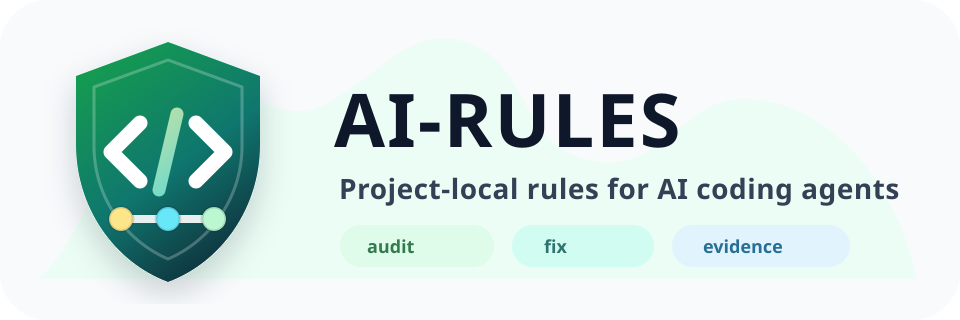
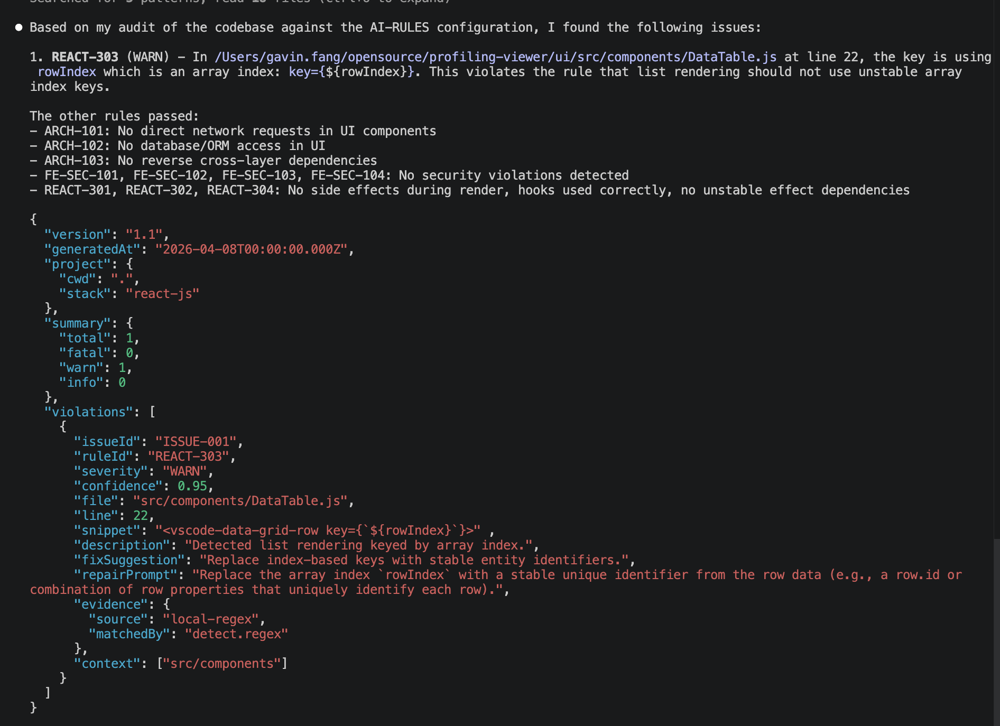
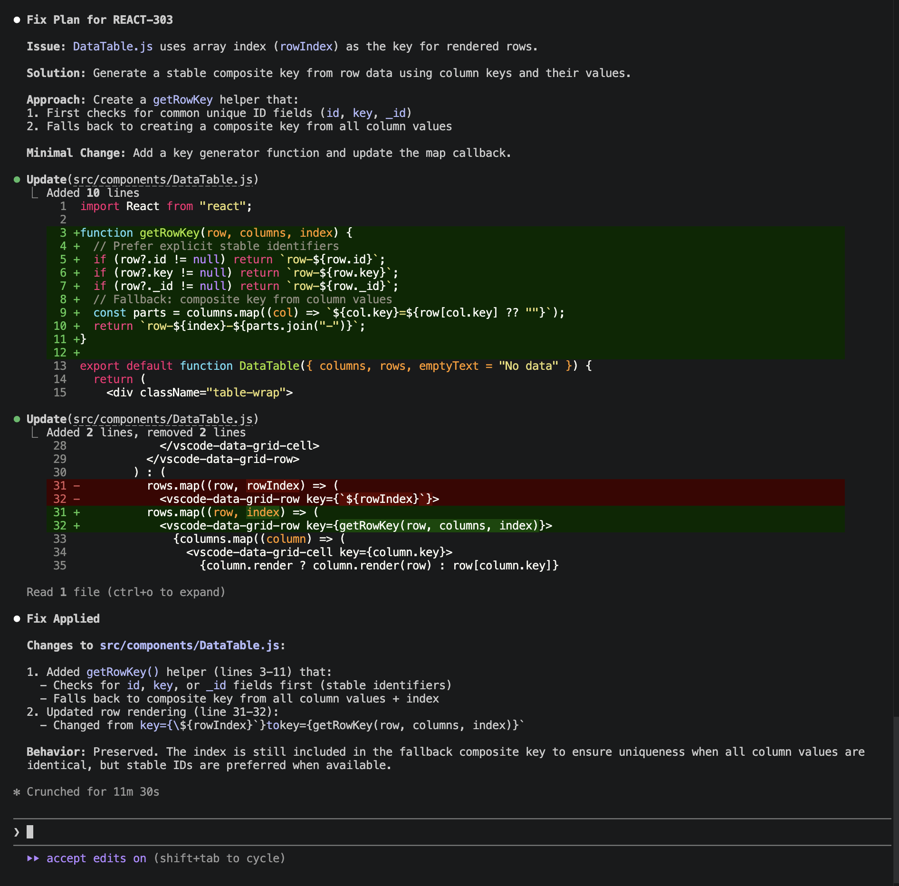

<p align="center">
  
</p>

# AI-RULES

**Give your AI coding agent project rules it can review and repair against.**

AI-RULES turns your team's architecture and safety conventions into reusable rules, local code evidence, and focused audit and fix prompts. Keep those conventions in your repository and use them across AI coding tools.

Install the Agent skill directly, or use the optional `ai-law` CLI (Node.js 18+). MIT licensed.

[English](README.md) | [简体中文](README.zh-CN.md)

## Use in agent chat (no Node.js required)

The standalone [`ai-rules` skill](skills/ai-rules/SKILL.md) uses the agent's file tools for initialization, project-rule review, and selected repairs. Node.js and the CLI are optional for users; an existing `ai-law` engine can add AST evidence and deterministic validation.

Ask a skills-capable agent:

```text
Install the skills/ai-rules skill from https://github.com/fjb040911/ai-rules
```

Installation locations and refresh behavior depend on the host. Without an installer, copy the complete `skills/ai-rules` folder into a supported skill directory. A bare name does not guarantee discovery. Structured question UI is also host-dependent; conversational questions are the fallback.

Then work in your target project:

```text
Use ai-rules to initialize this project
Use ai-rules to initialize automatically with recommended settings
Use ai-rules to check code
Use ai-rules to review the current changes
Use ai-rules to fix ISSUE-001
```

Initialization preserves existing rules and configuration and adapts aliases to actual paths. Review writes `ai-rule-report.json` and `.ai-rules/cache/skill-review-coverage.json`, documenting coverage and limitations without modifying source code. Agent consistency checks are not equivalent to CLI validation.

Bundled assets provide 14 rendered, flattened templates in English and Simplified Chinese. Maintainers run `npm run build:skill` after changing source templates; `npm pack` also rebuilds assets. Build-time Node.js is not a runtime dependency of the basic skill.

## Why AI-RULES

An AI agent can produce working code that still breaks your project's conventions. A React component makes a network request directly. A Spring controller reaches into a repository. A driver drops an error-path cleanup. A model pipeline silently changes precision.

Writing those expectations into a project rule set gives each review a concrete starting point. AI-RULES compiles the rules, collects supported local evidence, and builds a prompt with rule IDs, severity, and a report schema.

| What you need | What AI-RULES provides |
| --- | --- |
| Stop repeating the same review comments | Versioned Markdown rules with intent, requirements, and repair guidance |
| Review against your actual directory layout | Path aliases in `config.json`, with warnings for missing paths |
| Investigate findings with concrete evidence | Local matches with file locations and stable evidence references |
| Carry an audit into a focused repair | A JSON report that can be validated and used to generate issue-specific fix prompts |
| Keep large reviews manageable | Context modes, evidence budgets, and review focus by rule or scope |

Start with a built-in template, adapt its paths, and add the conventions your team already uses in review.

## Run your first review

Install the CLI:

```bash
npm install -g ai-law
```

Inside the project you want to review:

```bash
ai-law init
ai-law doctor
ai-law audit
```

`init` lets you select a language and project template. Before auditing, open `.ai-rules/config.json` and map its paths to your repository. `doctor` checks configuration, rule references, and installed skills.

`audit` prints a generated prompt and attempts to copy it to your clipboard. Give that prompt to your AI coding agent. Ask the agent to review the code and save its final JSON as `ai-rule-report.json` in the project root.

Once the report exists:

```bash
ai-law validate-report
ai-law fix --issueId ISSUE-001
```

Use an issue ID from your report. `fix` generates a repair prompt; your AI agent applies the edits. Review the changes and run the project's tests.

<p align="center">
  
</p>

Each finding ties the problem to a rule and gives the next repair step a stable issue ID.

<p align="center">
  
</p>

A fix prompt brings together the selected issue, rule requirements, and available evidence.

## Use it inside your AI coding tool

Generate reusable workflows with:

```bash
ai-law setup --provider claude-code --write
```

Replace `claude-code` with `cursor`, `codex`, `copilot`, or `custom` for the corresponding layout.

| Workflow | CLI action | Report |
| --- | --- | --- |
| `law-audit` | `ai-law audit` | `ai-rule-report.json` |
| `law-fix` | `ai-law fix --issueId <ISSUE_ID>` | Uses the architecture audit report |
| `law-logic` | `ai-law inspect-logic --profile logic` | `ai-logic-report.json` |
| `law-native` | `ai-law inspect-logic --profile native` | `ai-native-report.json` |
| `law-model` | `ai-law inspect-logic --profile model` | `ai-model-report.json` |

Invoke the generated `/law-*` workflows where your client supports them. For tools that require explicit skill selection, select the matching skill. Generic workflows can also be followed manually.

| Provider | Generated files |
| --- | --- |
| `claude-code` | `.claude/skills/law-*/SKILL.md` |
| `cursor` | `.cursor/skills/law-*/SKILL.md` |
| `codex` | `$CODEX_HOME/skills/law-*/SKILL.md`, defaulting to `~/.codex/skills/` |
| `copilot` | `.github/prompts/law-*.prompt.md` |
| `custom` | `.ai-rules/skills/law-*/SKILL.md` |

Re-run `setup --write` to update managed workflow content. It also removes legacy command files for the selected provider and records the installation in `.ai-rules/cache/skill-manifest.json`. `doctor` checks that the recorded files still exist.

Claude Code workflows use dynamic CLI output injection. Setup adds `Bash(ai-law:*)` to `.claude/settings.local.json` under `permissions.allow`. If execution is blocked, check the client's permissions settings.

## Templates for your stack

Framework templates inherit their base rules through `extends`. You can add project rules and tune the enabled set.

| Project family | Templates | Selected review topics |
| --- | --- | --- |
| Frontend | `frontend-base`, `react-js`, `react-ts`, `vue` | UI/service boundaries, unsafe HTML, dynamic execution, hooks, list keys, Vue props and computed purity |
| Desktop and extensions | `electron`, `vscode-extension` | Desktop and extension-host conventions built on the frontend foundation |
| Node.js | `nodejs-base`, `express`, `nestjs` | Transport/service/repository layering, async errors, sensitive logging, outbound timeouts |
| Python and AI models | `python-base`, `python-fastapi` | Exception handling, subprocess boundaries, timeouts, input/output contracts, model and checkpoint consistency |
| Java | `java-base`, `java-spring` | Thin controllers, input validation, security configuration, transaction boundaries, sensitive logging |
| C / C++ | `c-cpp` | Resource lifetime, critical return values, lock ordering, DMA lifecycles, firmware/protocol validation |

Rules provide both locally detectable patterns and guidance for AI reasoning. A topic listed here does not imply complete automatic detection.

### Frontend AST evidence

Selected JS, TS, React, and Vue rules use parser-backed local evidence. Current checks include:

- Direct `fetch()` or `axios.*` calls in UI code
- `innerHTML` and `dangerouslySetInnerHTML` usage
- Dynamic execution with `eval()` or `Function()`
- React and Vue list keys based on loop indexes
- Vue props mutation in supported `.vue` script blocks
- TypeScript `any` usage in TS/TSX files

Python, Java, and C/C++ do not have a supported local AST backend in this release. Unsupported AST checks stay AI-guided rather than invoking a frontend parser.

## Review logic, native code, and model pipelines

Choose a profile for the risks you want to investigate:

```bash
ai-law inspect-logic --profile logic
ai-law inspect-logic --profile native
ai-law inspect-logic --profile model
```

| Profile | Review focus |
| --- | --- |
| `logic` | Authorization, ownership, state transitions, replay/idempotency, tenant isolation, workflow bypasses |
| `native` | Ownership/lifetime, critical returns, lock protocols, parser boundaries, privileged operations, cleanup and rollback |
| `model` | Shape/dtype/device contracts, precision fallback, checkpoint compatibility, train/eval mode, tokenizer and postprocessing consistency |

Without `--profile`, C/C++ defaults to `native`, Python templates to `model`, and other stacks to `logic`. Use an explicit profile when you need a specific report filename.

These commands assemble review prompts and report templates. The AI agent investigates the source and writes the report. Logic/native/model reports use a separate `risks` schema; `validate-report` and `fix` currently consume `ai-rule-report.json`.

## Keep review context small

Both `audit` and `inspect-logic` default to `balanced`. Rules in the selected review scope retain their requirements, including rules without local matches. Evidence is prioritized by rule severity.

| Mode | Initial rule detail | Evidence rules | Matches/candidates per rule | Snippet/description characters |
| --- | --- | --- | --- | --- |
| `compact` | Rule summaries | 6 | 2 | 160 |
| `balanced` | Summaries; audit expands rules with selected evidence | 12 | 3 | 240 |
| `full` | Expanded rule details | Unlimited by default | Unlimited by default | Unlimited by default |

```bash
ai-law audit --context-mode compact
ai-law audit --rule ARCH-101 --context-mode full
ai-law audit --scope ui --max-evidence-rules 8 --max-matches-per-rule 2 --max-snippet-chars 180
ai-law inspect-logic --profile native --context-mode compact
```

`--rule` and `--scope` match exact enabled rule IDs and scope names. You can combine them. Review individual rules in full mode when you need more evidence.

Budgets affect prompt output. `--json` and cached artifacts keep the full collected data for validation and fixes. Prompts disclose omitted evidence; omitted matches do not establish that the code is safe. These limits control evidence size rather than enforce a hard token ceiling.

Generated skills use the prompt first and read source files or detailed rule evidence on demand. Refresh older skills with `setup --write`. Pasting full cache files alongside the prompt repeats much of the same context.

## Adapt the rules to your repository

The generated files have separate jobs:

| File | Purpose |
| --- | --- |
| `.ai-rules/.ai-rules.md` | Rule definitions, intent, detection hints, and repair guidance |
| `.ai-rules/rules-config.json` | Enabled rules, scopes, severity threshold, inheritance, and scan options |
| `.ai-rules/config.json` | Project-specific overrides, including paths and parser settings |
| `.ai-rules/cache/` | Generated context, evidence, validator output, and report templates |

Local `config.json` overrides the merged rules configuration. Adjust aliases and include/exclude patterns to match the files you want reviewed.

### Directory aliases

A repository with a small directory structure can map several aliases to the same directory:

```json
{
  "pathAliases": {
    "@components": "src",
    "@services": "src",
    "@apiClient": "src"
  }
}
```

Map each alias used by your chosen template to the corresponding real directory. If you remove an alias, update rules that reference it. `doctor` and `audit` warn when configured paths do not exist.

Aliases resolve in rule `context` and supported detection paths. `context` identifies supporting files or directories; it does not define the entire review target. Supported `detect.where` expressions and scan include/exclude patterns determine local evidence collection.

### Write a project rule

```md
### RULE: CUSTOM-101
severity: FATAL
scope: ui
intent: UI components must keep network requests in the service layer.
detect:
  regex: "fetch[(]|axios[.]"
  where: filePath in @components/**
fix: Move request logic into a service.
prompt:
  violation: Direct request logic found in the UI layer.
  requirement: UI components must delegate requests to a service.
  solution: Use a shared client from the service layer.
context:
  - @services
  - @apiClient
```

Enable the rule ID and its scope in `rules-config.json`, then run `doctor`. Use stable rule IDs so reports and repairs can reference the same convention.

### Configure thresholds and exceptions

```json
{
  "thresholds": {
    "maxFunctionLines": 80,
    "maxParamsCount": 5
  },
  "exceptions": {
    "ARCH-101": ["src/integrations/**"],
    "SEC-*": ["__mocks__/**", "**/*.stories.tsx"]
  }
}
```

Active count rules can reference these thresholds. Exceptions suppress matching files for supported local evidence checks.

### Configure frontend parsing

```json
{
  "ast": {
    "provider": "babel",
    "target": "react",
    "useProjectConfig": true,
    "parserOptions": {
      "sourceType": "module",
      "plugins": ["jsx", "typescript"]
    }
  }
}
```

Parser settings merge in this order: template defaults, detected project configuration such as `tsconfig.json` or Babel configuration, then local overrides. Keep parser-specific configuration in its existing project files and use `config.json` for AI-RULES overrides.

## Evidence and report boundaries

| Detection type | Current behavior |
| --- | --- |
| `regex` | Local pattern matches |
| `import` / `include` | Local dependency/include evidence |
| `count` | Local `function-lines` and `params-count` evidence |
| Supported frontend `ast` checks | Parser-backed local evidence |
| `semantic` and unsupported `ast` checks | AI-guided review |

The CLI compiles context locally and generates prompts; it does not call a hosted AI model to complete the audit. Your chosen AI tool determines how the supplied project context is processed.

Local evidence is a review candidate. AI review still needs source inspection and cross-file reasoning. Report validation checks structure and available rule/evidence references; it does not prove a finding is correct. Keep your tests, linters, security tools, and code review in the workflow.

`audit` writes these artifacts by default:

```text
.ai-rules/cache/audit-context.json
.ai-rules/cache/rule-ir.json
.ai-rules/cache/rule-validator.json
.ai-rules/cache/ai-rule-report.template.json
```

The AI-generated `ai-rule-report.json` uses schema version `1.1`, a project summary, and a `violations` array. Findings have unique `issueId` values, rule IDs, severity, locations, repair guidance, and optional evidence references. `validate-report` normalizes compatible legacy formats and checks required fields, duplicate IDs, and available rule/evidence relationships.

## CLI reference

```bash
ai-law init
ai-law audit [--locale <code>] [--json] [--summary] [--dry-run] [--dump-context]
ai-law inspect-logic [--locale <code>] [--profile logic|native|model] [--json] [--dump-context]
ai-law fix --issueId <issue_id>
ai-law fix --id <rule_id>
ai-law fix --all [--group-by-rule]
ai-law doctor [--strict]
ai-law validate-report [--json] [--path <file>]
ai-law setup [--locale <code>] [--provider <name>] [--write]
ai-law -v
ai-law -h
```

Prompt options for `audit` and `inspect-logic`:

```text
--context-mode compact|balanced|full
--rule <rule_id>
--scope <scope>
--max-evidence-rules <n>
--max-matches-per-rule <n>
--max-snippet-chars <n>
```

Use `audit --summary` for coverage counts, `audit --dry-run` for the local/AI review plan, and `audit --json` for full structured context. `--dump-context` explicitly rewrites the cache. `doctor --strict` treats warnings as failures.

## Languages

Rule and prompt locales include `en`, `zh-CN`, `zh-TW`, `ja`, `ko`, `es`, and `fr`. English and Simplified Chinese have complete locale files. The remaining locales are partial; missing strings fall back to English.

Choose a language during initialization or pass `--locale` when generating prompts.

## The rules compiler direction

AI-RULES compiles project-authored Markdown into normalized Rule IR, validator decisions, evidence references, and repair hints. Audit and fix workflows share that rule model.

The next stages are described in the [version evolution plan](docs/version-evolution-plan.md). The current CLI already produces these artifacts for agents; broader execution and enforcement remain roadmap work.

## Development and design

```bash
npm install
npm test
node cli/src/index.js --help
```

- [Design specification](design/design-spec-en.md)
- [Architecture evolution](docs/演进方向.md)
- [Version evolution plan](docs/version-evolution-plan.md)
- [License information](package.json)
